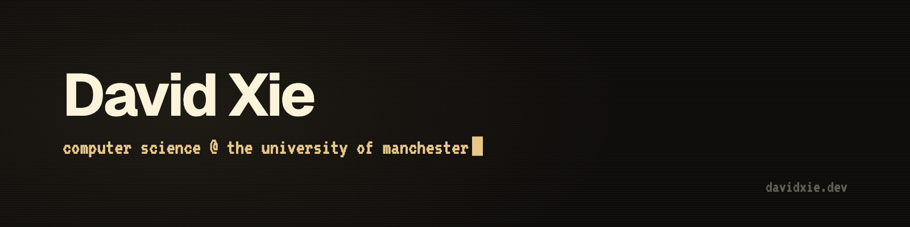
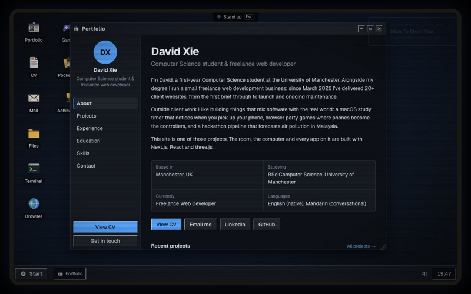
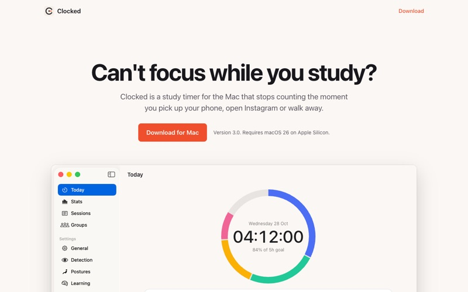
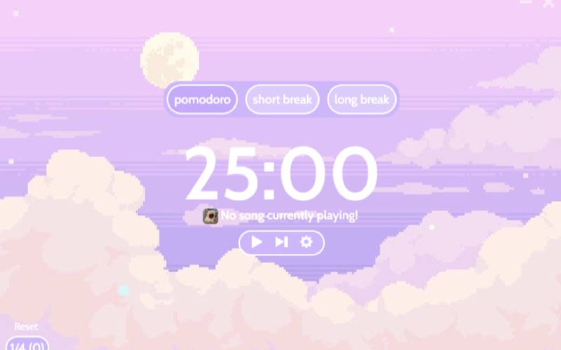

  
  
  
  

<h3 align="center">Featured Projects</h3>

<table>
  <tr>
    <td width="33%" align="center">
       
      <a href="https://davidxie.dev"><b>DAVID-OS</b></a>
    </td>
    <td width="33%" align="center">
       
      <a href="https://snakeluck360gt.github.io/clocked/"><b>Clocked</b></a>
    </td>
    <td width="33%" align="center">
       
      <a href="https://github.com/SnakeLuck360GT/pomoapp"><b>PomoApp</b></a>
    </td>
  </tr>
</table>

<h3 align="center">Languages and Tools</h3>

  

